<p align="center">
  
</p>

<p align="center">
  <a href="https://github.com/ishandutta2007/wAwesome-Awesome-Awesome"></a><a href="https://discord.gg/jc4xtF58Ve"></a>
  <a href="https://github.com/ishandutta2007/Awesome-Version-Managers/stargazers"></a>
  <a href="https://github.com/ishandutta2007/Awesome-Version-Managers/pulls"></a>
  <a href="https://opensource.org/licenses/MIT"></a>
  <a href="https://github.com/ishandutta2007/Awesome-Version-Managers"></a>
  <a href="https://github.com/ishandutta2007"></a>
</p>

---

# ⚡ Awesome Version Managers

> 🌟 **The definitive curated directory of Language Runtime Managers, Multi-Tool Version Switching CLIs, Shims, Polyglot Toolchains, and Cloud Developer Environments.**

Whether you are working in **Node.js, Python, Ruby, Java, Go, Rust, PHP, Flutter, or Terraform**, switching between compiler and runtime versions across projects is an everyday necessity. Version managers isolate environments per shell, per user, or per project directory (via `.tool-versions`, `.node-version`, `.python-version`), eliminating version conflicts and ensuring reproducible builds across local machines and CI/CD pipelines.

---

## 📑 Table of Contents

- [🔍 SEO & Architecture Overview](#-seo--architecture-overview)
- [🌐 Sector Overview & Market Dynamics](#-sector-overview--market-dynamics)
- [🏢 SaaS & Managed Cloud Runtime Platforms](#-saas--managed-cloud-runtime-platforms)
- [⭐ Open-Source Version Managers (Ranked by Stars)](#-open-source-version-managers-ranked-by-stars)
  - [🏆 Top 25 Ranked Leaderboard](#-top-25-ranked-leaderboard)
  - [🔀 Multi-Language / Polyglot Managers](#-multi-language--polyglot-managers)
  - [⬢ Node.js Version Managers](#-nodejs-version-managers)
  - [🐍 Python Version Managers](#-python-version-managers)
  - [💎 Ruby Version Managers](#-ruby-version-managers)
  - [☕ Java / JVM Version Managers](#-java--jvm-version-managers)
  - [🦀 Rust Toolchain Managers](#-rust-toolchain-managers)
  - [🐹 Go Version Managers](#-go-version-managers)
  - [🐘 PHP Version Managers](#-php-version-managers)
  - [☁️ Infrastructure, IaC & Mobile Managers](#️-infrastructure-iac--mobile-managers)
- [💡 How Version Managers Work: Shims vs Environment Variables](#-how-version-managers-work-shims-vs-environment-variables)
- [🤝 How to Contribute](#-how-to-contribute)
- [💖 Support & Community](#-support--community)
- [📈 Star History](#-star-history)
- [📜 License & Disclaimer](#-license--disclaimer)

---

## 🔍 SEO & Architecture Overview

Modern software development relies heavily on multiple concurrent runtime versions. Developers search for solutions to avoid dependency collisions, manage `.nvmrc` and `.tool-versions` files, and achieve parity between local laptops (macOS/Linux/Windows) and automated CI workflows.

### Key Concepts & Terms:
* **Shims**: Lightweight wrapper scripts placed early in `$PATH` that intercept CLI calls and dynamically dispatch to the active runtime version (e.g., `asdf`, `mise`, `rbenv`, `pyenv`).
* **Environment Variable Switchers**: Shell functions modifying `PATH` on directory entry (`chpwd` / shell hooks) for zero execution overhead (e.g., `fnm`, `chruby`).
* **Polyglot Managers**: Single unified CLI managing dozens of languages simultaneously, reducing tool sprawl (e.g., `mise`, `asdf`, `proto`).
* **Cloud Development Environments (CDEs)**: Browser-accessible or remote containerized workspaces where runtime orchestration is offloaded to managed cloud compute (e.g., GitHub Codespaces, Gitpod, Coder).

---

## 🌐 Sector Overview & Market Dynamics

The global **Cloud Development Environment (CDE) and Developer Workspace** market was valued at approximately **$4.8 Billion** and is projected to surge past **$13.5 Billion by 2030**, advancing at a robust compound annual growth rate (**CAGR**) of **~18.5%**.

The sector demonstrates a **moderately fragmented yet increasingly concentrated structure**:
- **Hyperscaler Dominance**: Tech giants (Microsoft via GitHub Codespaces, Alphabet via Google Cloud Workstations, Amazon via AWS CodeCatalyst) dominate enterprise customer acquisition due to built-in cloud IAM, single-billing consolidation, compliance certifications (SOC2, HIPAA, FedRAMP), and global container infrastructure.
- **High-Velocity Specialists**: Independent innovators (Replit, Gitpod, Coder, StackBlitz) preserve agile competitive moats by pioneering sub-second boot times, in-browser WebContainer execution, self-hosted Kubernetes flexibility, and autonomous AI programming agents.
- **Open-Source Standard**: On local workstations, fully open-source CLI utilities remain the undisputed standard—commanding virtually 100% developer mindshare due to zero latency, offline reliability, and privacy.

---

## 🏢 SaaS & Managed Cloud Runtime Platforms

Cloud-hosted development environments abstract local runtime installation altogether by provisioning ephemeral containers or virtual machines pre-configured with language runtimes and SDKs.

The table below is **sorted by Company Size / Valuation (descending)**:

| 🏢 Platform / Service | 🎯 Category / Primary Focus | 💰 Company Valuation / Size | 🏷️ Starting Paid Tier | 🎁 Free Tier Limits / Free Trial |
| :--- | :--- | :--- | :--- | :--- |
| **[GitHub Codespaces](https://github.com/features/codespaces)** | Cloud Dev Environments (CDE) & Dev Containers | **$3,100 Billion** *(Microsoft Market Cap)* | **$0.18 / core-hour** *(2 cores, 4 GB RAM) + $0.07/GB-mo storage* | **Free Forever**: 120 core-hours/month + 15 GB storage/month on personal GitHub Free accounts *(180 core-hours on Pro)* |
| **[Google Cloud Workstations](https://cloud.google.com/workstations)** | Managed Enterprise Developer Workstations | **$2,100 Billion** *(Alphabet Market Cap)* | **$0.05 / compute-hour** *(e2-standard-2) + $0.20/workstation/mo control plane* | **90-Day Free Trial**: $300 in Google Cloud credits applicable across all GCP services including Workstations |
| **[AWS CodeCatalyst / Cloud9](https://aws.amazon.com/codecatalyst/)** | Cloud Workspaces & Automated Dev Environments | **$2,000 Billion** *(Amazon Market Cap)* | **$7.00 / user / month** *(Enterprise tier; compute starts at $0.0464/hr for 2 vCPU on EC2)* | **Free Forever**: 2,000 compute minutes/month + 64 GB storage/month on CodeCatalyst; AWS Cloud9 includes 750 hrs/mo t2/t3.micro for 12 months |
| **[Heroku](https://www.heroku.com/)** | Managed Application PaaS & Language Buildpacks | **$280 Billion** *(Salesforce Market Cap)* | **$5.00 / month** *(Eco Dyno shared pool of 1,000 hours) or $7.00/mo (Basic Dyno)* | **No Permanent Free Tier**: Credit-card required; Student/nonprofit access available via GitHub Student Pack granting $13/mo credits (1,000 dyno hours) for 12 months |
| **[Replit](https://replit.com/)** | Collaborative Cloud IDE & AI Agent Workspace | **$3.0 Billion** *(Series B Valuation)* | **$20.00 / month** *(Replit Core billed monthly, $18.00/mo billed annually)* | **Free Forever Starter**: 1 vCPU, 2 GiB memory, 2 GiB storage, 1 published app *(sleeps after 5 min idle)*, ~1,200 dev minutes/month |
| **[Coder](https://coder.com/)** | Self-Hosted & Enterprise Cloud Dev Environments | **$200 Million** *(Venture Valuation, $47M raised)* | **$30.00 / user / month** *(Coder Enterprise platform tier)* | **Free Forever Community Edition**: Self-hosted open source for up to 10 active developers/workspaces; 30-day Enterprise cloud trial |
| **[Gitpod](https://www.gitpod.io/)** | Automated Ephemeral Workspaces & CDE Platform | **$180 Million** *(Venture Valuation, $38M raised)* | **$9.00 / user / month** *(Pay-as-you-go base platform fee) or $0.36/hr compute packs* | **Free Forever**: 500 workspace credits/month *(~50 standard hours)*, up to 4 concurrent workspaces, 30-minute inactivity timeout |
| **[StackBlitz](https://stackblitz.com/)** | Instant In-Browser Node.js WebContainers | **$150 Million** *(Series A Valuation, $35M raised)* | **$8.00 / user / month** *(Personal Pro billed annually, $9.00/mo monthly)* | **Free Forever**: Unlimited public repositories, instant zero-latency WebContainer sandboxes, 1 concurrent private project |

---

## ⭐ Open-Source Version Managers (Ranked by Stars)

Open-source version managers represent the daily drivers for tens of millions of engineers worldwide. Below is our complete catalog, **rigorously sorted in descending order by GitHub Stars**.

### 🏆 Top 25 Ranked Leaderboard

| 🏅 Rank | 📦 Project Name | 🌟 GitHub Stars Badge | 💻 Target Ecosystem | ⚡ Primary Technology |
| :---: | :--- | :--- | :--- | :--- |
| **1** | **[nvm](https://github.com/nvm-sh/nvm)** | [](https://github.com/nvm-sh/nvm/stargazers) | Node.js | Shell / POSIX |
| **2** | **[uv](https://github.com/astral-sh/uv)** | [](https://github.com/astral-sh/uv/stargazers) | Python (Runtimes & Packages) | Rust |
| **3** | **[nvm-windows](https://github.com/coreybutler/nvm-windows)** | [](https://github.com/coreybutler/nvm-windows/stargazers) | Node.js (Windows native) | Go |
| **4** | **[pyenv](https://github.com/pyenv/pyenv)** | [](https://github.com/pyenv/pyenv/stargazers) | Python | Shell |
| **5** | **[mise](https://github.com/jdx/mise)** | [](https://github.com/jdx/mise/stargazers) | Polyglot (Multi-Language) | Rust |
| **6** | **[fnm](https://github.com/Schniz/fnm)** | [](https://github.com/Schniz/fnm/stargazers) | Node.js | Rust |
| **7** | **[asdf](https://github.com/asdf-vm/asdf)** | [](https://github.com/asdf-vm/asdf/stargazers) | Polyglot (Multi-Language) | Shell / Go |
| **8** | **[n](https://github.com/tj/n)** | [](https://github.com/tj/n/stargazers) | Node.js | Shell |
| **9** | **[rbenv](https://github.com/rbenv/rbenv)** | [](https://github.com/rbenv/rbenv/stargazers) | Ruby | Shell |
| **10** | **[Volta](https://github.com/volta-cli/volta)** | [](https://github.com/volta-cli/volta/stargazers) | JavaScript / Node.js / Yarn | Rust |
| **11** | **[gvm](https://github.com/moovweb/gvm)** | [](https://github.com/moovweb/gvm/stargazers) | Go (Golang) | Shell |
| **12** | **[rustup](https://github.com/rust-lang/rustup)** | [](https://github.com/rust-lang/rustup/stargazers) | Rust | Rust |
| **13** | **[SDKMAN!](https://github.com/sdkman/sdkman-cli)** | [](https://github.com/sdkman/sdkman-cli/stargazers) | Java, Kotlin, Scala, Groovy | Shell / Bash |
| **14** | **[jenv](https://github.com/jenv/jenv)** | [](https://github.com/jenv/jenv/stargazers) | Java JDK | Shell |
| **15** | **[FVM](https://github.com/leoafarias/fvm)** | [](https://github.com/leoafarias/fvm/stargazers) | Flutter SDK | Dart |
| **16** | **[phpbrew](https://github.com/phpbrew/phpbrew)** | [](https://github.com/phpbrew/phpbrew/stargazers) | PHP | PHP |
| **17** | **[RVM](https://github.com/rvm/rvm)** | [](https://github.com/rvm/rvm/stargazers) | Ruby | Shell |
| **18** | **[tfenv](https://github.com/tfutils/tfenv)** | [](https://github.com/tfutils/tfenv/stargazers) | Terraform | Shell |
| **19** | **[nvs](https://github.com/jasongin/nvs)** | [](https://github.com/jasongin/nvs/stargazers) | Node.js (Cross-Platform) | Shell / PowerShell |
| **20** | **[chruby](https://github.com/postmodern/chruby)** | [](https://github.com/postmodern/chruby/stargazers) | Ruby | Shell |
| **21** | **[goenv](https://github.com/go-nv/goenv)** | [](https://github.com/go-nv/goenv/stargazers) | Go (Golang) | Shell |
| **22** | **[nodenv](https://github.com/nodenv/nodenv)** | [](https://github.com/nodenv/nodenv/stargazers) | Node.js | Shell |
| **23** | **[phpenv](https://github.com/phpenv/phpenv)** | [](https://github.com/phpenv/phpenv/stargazers) | PHP | Shell |
| **24** | **[tenv](https://github.com/tofuutils/tenv)** | [](https://github.com/tofuutils/tenv/stargazers) | OpenTofu, Terraform, Terragrunt | Go |
| **25** | **[proto](https://github.com/moonrepo/proto)** | [](https://github.com/moonrepo/proto/stargazers) | Polyglot (Multi-Language) | Rust |

---

### 🔀 Multi-Language / Polyglot Managers

Polyglot tools eliminate the need to learn and maintain separate version managers for each language by consolidating toolchain management into a single CLI and shared configuration format (such as `.tool-versions`).

- **[mise](https://github.com/jdx/mise)** [](https://github.com/jdx/mise/stargazers)  
  *Blazing-fast polyglot runtime manager and environment orchestrator written in Rust.* Full compatibility with asdf plugin ecosystem, environment variable management (`.env`), and task runner capabilities.
- **[asdf](https://github.com/asdf-vm/asdf)** [](https://github.com/asdf-vm/asdf/stargazers)  
  *The extensible polyglot pioneer.* Manages Node.js, Python, Ruby, Elixir, Terraform, and hundreds more through an extensive community-maintained plugin architecture and single `.tool-versions` config.
- **[proto](https://github.com/moonrepo/proto)** [](https://github.com/moonrepo/proto/stargazers)  
  *Next-generation multi-toolchain version manager by Moonrepo.* Built with Rust and WebAssembly (WASM) plugins for cross-platform consistency, blazing execution, and reproducible toolchains.

---

### ⬢ Node.js Version Managers

- **[nvm](https://github.com/nvm-sh/nvm)** [](https://github.com/nvm-sh/nvm/stargazers)  
  *The undisputed gold standard for Node.js version switching.* POSIX-compliant bash script allowing developers to install, switch, and alias active Node.js versions per session.
- **[nvm-windows](https://github.com/coreybutler/nvm-windows)** [](https://github.com/coreybutler/nvm-windows/stargazers)  
  *Native Windows Node.js version management utility.* Built in Go with symlink manipulation to seamlessly swap active Node versions on Windows without bash prerequisites.
- **[fnm](https://github.com/Schniz/fnm)** [](https://github.com/Schniz/fnm/stargazers)  
  *Fast and simple Node.js manager built in Rust.* 40x faster shell startup than shell-based managers; supports `.node-version` and `.nvmrc` with automatic directory switching.
- **[n](https://github.com/tj/n)** [](https://github.com/tj/n/stargazers)  
  *Interactive Node.js version management.* Simple, zero-subshell shell script allowing visual navigation and switching between installed and remote Node versions.
- **[Volta](https://github.com/volta-cli/volta)** [](https://github.com/volta-cli/volta/stargazers)  
  *Hassle-free JavaScript toolchain manager built in Rust.* Automatically detects and enables project-specific Node, npm, and yarn versions without shell hooks via deterministic shims.
- **[nvs](https://github.com/jasongin/nvs)** [](https://github.com/jasongin/nvs/stargazers)  
  *Cross-platform tool for switching between Node.js versions.* Windows, macOS, and Linux support with native binary installs and interactive menus.
- **[nodenv](https://github.com/nodenv/nodenv)** [](https://github.com/nodenv/nodenv/stargazers)  
  *Rbenv-style Node version manager.* Lightweight, shim-based architecture ensuring isolation without overriding shell builtins.

---

### 🐍 Python Version Managers

- **[uv](https://github.com/astral-sh/uv)** [](https://github.com/astral-sh/uv/stargazers)  
  *Extremely fast Python package and toolchain manager written in Rust.* Installs, manages, and executes multiple Python versions on-demand (`uv python install 3.12`), replacing pip, pipx, poetry, and pyenv in one tool.
- **[pyenv](https://github.com/pyenv/pyenv)** [](https://github.com/pyenv/pyenv/stargazers)  
  *The community standard for Python runtime management.* Seamlessly builds and switches between CPython, PyPy, Anaconda, and active virtualenvs using lightweight shims and `.python-version`.

---

### 💎 Ruby Version Managers

- **[rbenv](https://github.com/rbenv/rbenv)** [](https://github.com/rbenv/rbenv/stargazers)  
  *Minimalist Ruby version management.* Intercepts Ruby commands using shims, delegating compiler tasks to plugins like `ruby-build`.
- **[RVM](https://github.com/rvm/rvm)** [](https://github.com/rvm/rvm/stargazers)  
  *Comprehensive Ruby environment manager.* Manages multiple Ruby releases and isolated gem collections (gemsets) with rich scripting facilities.
- **[chruby](https://github.com/postmodern/chruby)** [](https://github.com/postmodern/chruby/stargazers)  
  *Non-intrusive Ruby switcher.* Operates under 90 lines of shell code with zero shims, zero PATH manipulation bugs, and clean environment variable switching.

---

### ☕ Java / JVM Version Managers

- **[SDKMAN!](https://github.com/sdkman/sdkman-cli)** [](https://github.com/sdkman/sdkman-cli/stargazers)  
  *The premier Software Development Kit manager for Java and the JVM.* Installs and switches between OpenJDK distributions (Temurin, Corretto, GraalVM, Zulu) alongside Maven, Gradle, Kotlin, and Scala.
- **[jenv](https://github.com/jenv/jenv)** [](https://github.com/jenv/jenv/stargazers)  
  *Java environment switcher modeled after rbenv.* Dynamically configures `JAVA_HOME` and JDK versions per project directory via `.java-version`.

---

### 🦀 Rust Toolchain Managers

- **[rustup](https://github.com/rust-lang/rustup)** [](https://github.com/rust-lang/rustup/stargazers)  
  *The official Rust toolchain installer and version manager.* Manages compiler releases (stable, beta, nightly), cross-compilation target architectures, and components (`rust-analyzer`, `clippy`).

---

### 🐹 Go Version Managers

- **[gvm](https://github.com/moovweb/gvm)** [](https://github.com/moovweb/gvm/stargazers)  
  *Go Version Manager.* Provides complete Go environment switching with support for downloading binary releases or compiling Go toolchains from source.
- **[goenv](https://github.com/go-nv/goenv)** [](https://github.com/go-nv/goenv/stargazers)  
  *Go version management cloned from pyenv and rbenv.* Configures project-level Go installations and sets `GOROOT` automatically via `.go-version`.

---

### 🐘 PHP Version Managers

- **[phpbrew](https://github.com/phpbrew/phpbrew)** [](https://github.com/phpbrew/phpbrew/stargazers)  
  *Compiles and manages multiple PHP installations in user space.* Handles extension builds (pdo, xdebug, gd) and per-directory switching.
- **[phpenv](https://github.com/phpenv/phpenv)** [](https://github.com/phpenv/phpenv/stargazers)  
  *Thin, shim-based PHP version manager.* Works identically to rbenv to control active CLI PHP binaries per project.

---

### ☁️ Infrastructure, IaC & Mobile Managers

- **[FVM](https://github.com/leoafarias/fvm)** [](https://github.com/leoafarias/fvm/stargazers)  
  *Flutter Version Management.* Enables developers to define and switch Flutter SDK releases per project, guaranteeing consistent app compilation across development teams.
- **[tfenv](https://github.com/tfutils/tfenv)** [](https://github.com/tfutils/tfenv/stargazers)  
  *Terraform version manager.* Easily switch between multiple HashiCorp Terraform binary versions according to `.terraform-version` constraints.
- **[tenv](https://github.com/tofuutils/tenv)** [](https://github.com/tofuutils/tenv/stargazers)  
  *OpenTofu, Terraform, and Terragrunt unified version manager.* Written in Go with automatic version detection and signature verification.

---

## 💡 How Version Managers Work: Shims vs Environment Variables

Understanding the underlying mechanics of version managers helps developers pick the optimal tool for their performance and workflow requirements:

```
┌────────────────────────────────────────────────────────────────────────┐
│                        DEVELOPER CLI INVOCATION                        │
│                           $ node -v  /  $ python                       │
└───────────────────────────────────┬────────────────────────────────────┘
                                    │
           ┌────────────────────────┴────────────────────────┐
           ▼                                                 ▼
┌───────────────────────────────────┐     ┌───────────────────────────────────┐
│     SHIM ARCHITECTURE (asdf)      │     │    ENVIRONMENT HOOKS (fnm/uv)     │
│ 1. CLI invokes shim in /shims/    │     │ 1. Shell hook fires on 'cd'       │
│ 2. Shim reads .tool-versions file │     │ 2. Hook modifies $PATH directly   │
│ 3. Dispatches to target binary    │     │ 3. Execution runs with ZERO shim  │
│ [Adds 5-20ms latency per command] │     │ [Maximum execution performance]   │
└───────────────────────────────────┘     └───────────────────────────────────┘
```

1. **Shim-based Managers (`asdf`, `pyenv`, `rbenv`, `Volta`)**:
   - Place a directory of generic executable wrappers ("shims") at the front of your `$PATH`.
   - When a tool is executed, the shim inspects current working directories, parent folders, or global config files to locate `.tool-versions` or `.node-version`.
   - The shim then forwards the execution to the corresponding installed runtime binary.
   - *Advantage*: Works consistently across scripts, subshells, and non-interactive environments without shell reconfiguration.

2. **Environment & PATH-manipulation Managers (`fnm`, `chruby`, `uv`)**:
   - Install a lightweight shell integration hook that triggers whenever changing directories (`chpwd` in zsh, `cd` override in bash).
   - If the new directory contains a version configuration file, `$PATH` is altered to prepend the specific runtime's binary directory.
   - *Advantage*: Zero overhead during command invocation since binaries are invoked directly without intermediate script layers.

---

## 🤝 How to Contribute

We welcome additions, fixes, and ecosystem updates from the developer community!

1. 🍴 **Fork the repository** on GitHub.
2. 🌿 **Create a descriptive feature branch**: `git checkout -b feature/add-new-version-manager`.
3. 📝 **Edit [README.md](README.md)**: Add your tool adhering to alphabetical/ranked order, including accurate links, star badges, and concise descriptions.
4. ✅ **Ensure accuracy**: Verify that URLs resolve properly and data (pricing, free tiers, star badges) is accurate.
5. 🚀 **Submit a Pull Request** with a brief summary of the changes.

Please refer to the curated standard list at [Awesome-Awesome-Awesome](https://github.com/ishandutta2007/Awesome-Awesome-Awesome) for quality guidelines.

---

## 💖 Support & Community

A massive **thank you** to all open-source maintainers, contributors, and developers worldwide who make managing complex developer environments effortless!

If this repository has saved you debugging time or streamlined your development workflow:
- ⭐ **Star this repository** to help other engineers discover it!
- 🍴 **Fork and contribute** by adding upcoming tools or keeping entries up to date.
- 📢 **Share on social networks** (X/Twitter, LinkedIn, Reddit, Discord).
- ☕ **Support / Buy a Coffee**: Sponsor ongoing research and curation through the [GitHub Sponsor Dashboard](https://github.com/sponsors/ishandutta2007).

<p align="center">
  <a href="https://github.com/sponsors/ishandutta2007">
    
  </a>
</p>

---

## 📈 Star History

[](https://star-history.dera.page/#ishandutta2007/Awesome-Version-Managers&type=date&legend=top-left)

---

## 📜 License & Disclaimer

- **License**: Distributed under the [MIT License](https://opensource.org/licenses/MIT).
- **Disclaimer**: This is a community-curated directory. Product names, logos, and brands are property of their respective owners. Version managers execute shell scripts and manipulate system binaries—always review plugins and download installers from trusted upstream repositories. Pin runtime versions in production and CI to ensure deterministic builds.
